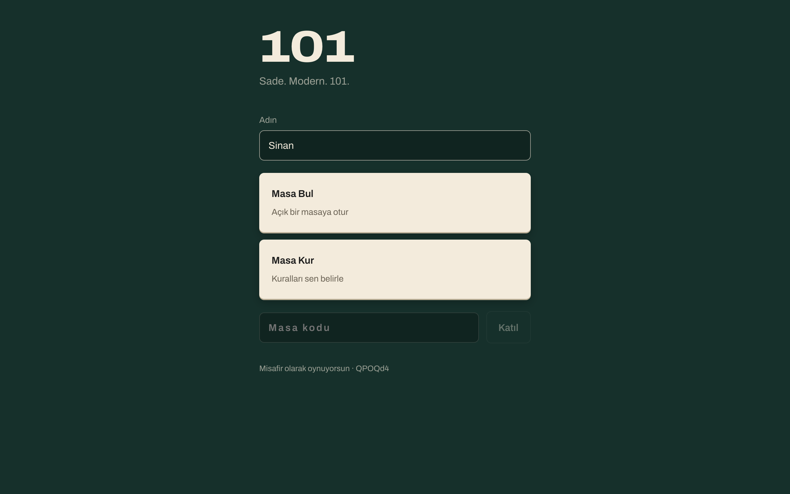
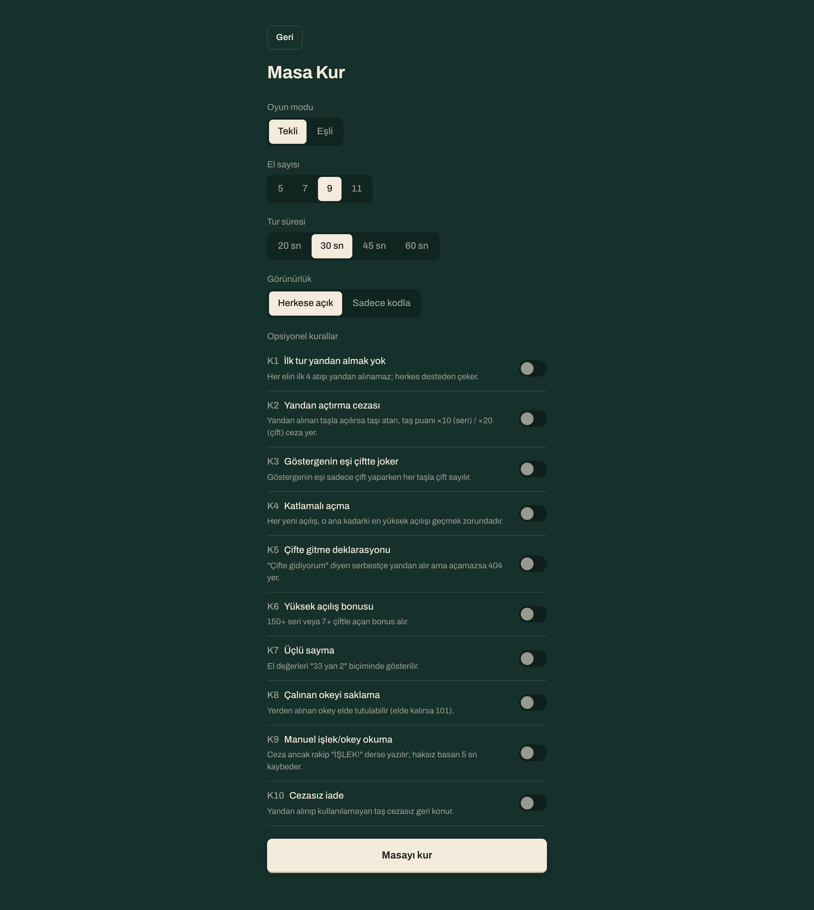
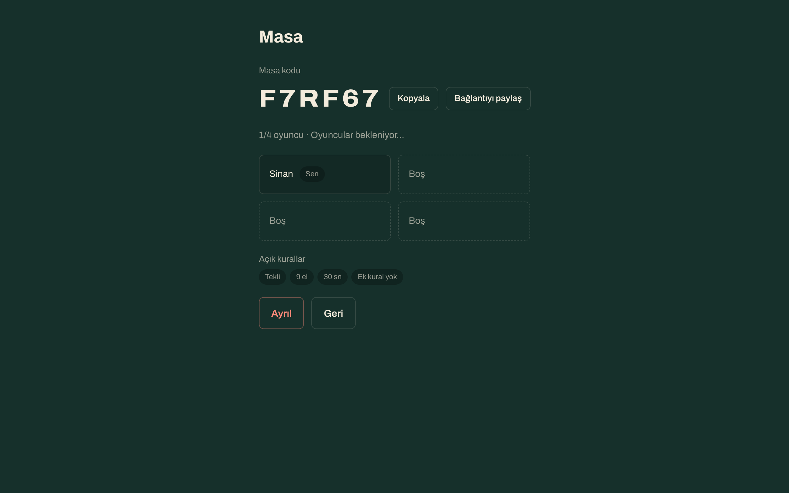
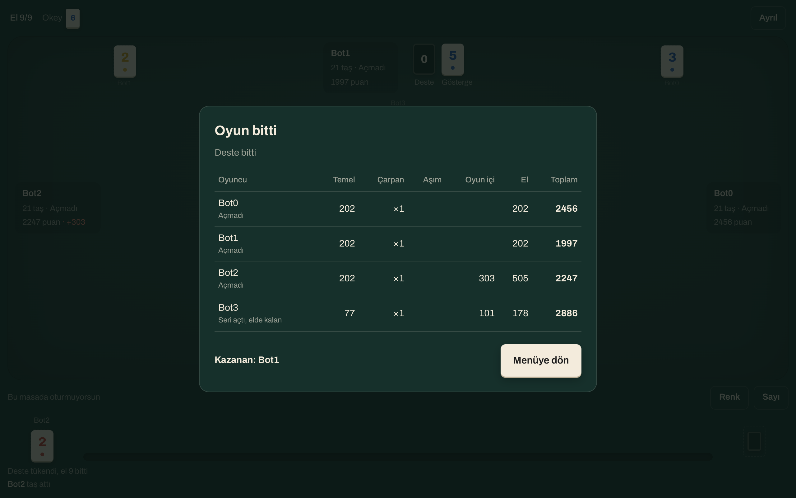
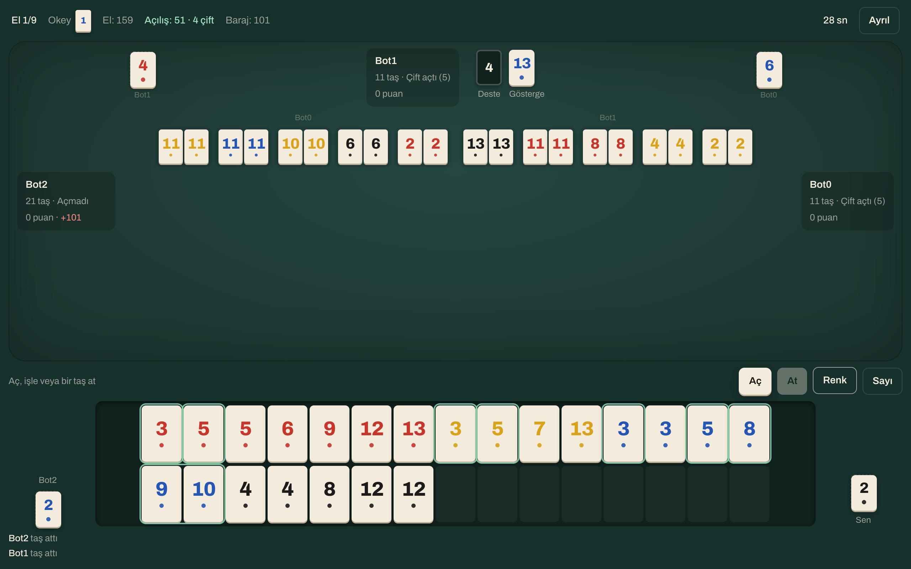
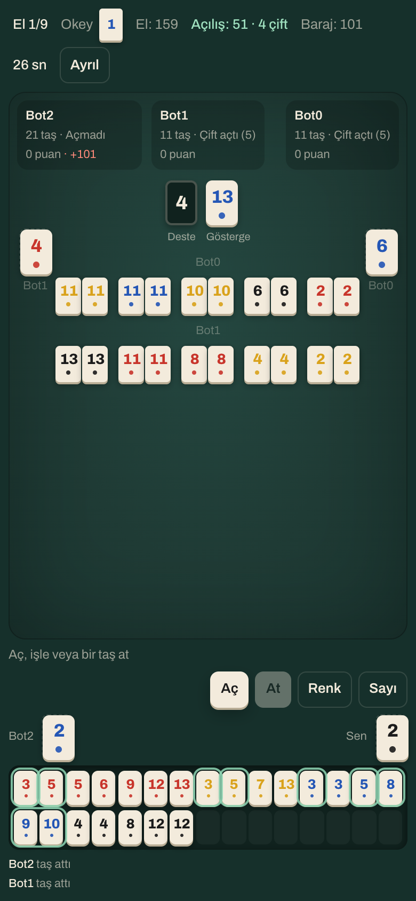

# 101 Okey

Online 4-player **101 Okey** (Turkish rummy) for the browser: create a table, share a six-letter code, pick your house rules, play.

**Live:** https://okey101-ce391.web.app

The rules engine runs only on the server (Firebase Functions), so clients can't cheat: every move is validated against the full match state and players only ever receive their own rack plus a public view of the table.

## Screenshots

| Menu | Table setup (10 optional rules) |
| --- | --- |
|  |  |

| Lobby | Final scoreboard |
| --- | --- |
|  |  |



<p align="center"></p>

## Features

- **Full 101 Okey rules**: dealing, gösterge/okey, side-take, opening with series (101+) or pairs (5+), extending melds, okey stealing, işlek penalties, deck exhaustion, finish multipliers, team mode.
- **Ten switchable house rules (K1–K10)**: no side-take on the first round, side-take opening penalty, gösterge's twin as pair joker, escalating openings, pairs declaration, high-opening bonus, "33 yan 2" counting, keeping stolen okeys, manual işlek calls, penalty-free return.
- **Server-authoritative engine**: a pure TypeScript engine (`applyAction`) with zero dependencies, bundled into Cloud Functions. Firestore holds the secret state, one private rack doc per player, and a public view.
- **Live opening counter**: the rack shows the best possible opening (points and pair count) as you arrange tiles, with rings around the tiles that would be used.
- **Staged opening with take-back**: lay out melds before committing; taking them back costs the penalty the rules require.
- **Turn timer with server clock sync**, automatic timeout discards, reconnect-safe state.
- **Guest play**: anonymous Firebase auth with per-tab sessions, so you can test four seats from four tabs.
- **Responsive table** that works from phones to wide desktops.
- **Bot harness**: four bots play complete matches through the emulated backend as an end-to-end test.

UI is Turkish (all strings in `packages/shared/src/i18n/tr.ts`); the engine and code are in English.

## Tech stack

- **TypeScript** everywhere, npm workspaces monorepo
- **Engine**: pure TS, tested with **Vitest** (44 tests covering every rule section and K1–K10)
- **Backend**: **Firebase** Functions v2 (`europe-west1`), Firestore, Anonymous Auth, Hosting; functions bundled with **esbuild**
- **Web**: **React 18**, **Vite 6**, react-router, plain CSS

## Running locally

Prerequisites: Node 22+, Java 21+ (for the Firestore emulator), and `npm i -g firebase-tools`.

```bash
git clone https://github.com/sinanhalef/okey-101.git
cd okey-101
npm install

# Firebase web config: create a Firebase project (Blaze plan for Functions),
# enable Anonymous Auth and Firestore, then paste the web-app config into apps/web/.env
cp apps/web/.env.example apps/web/.env
```

Run the tests and typecheck:

```bash
npm test            # engine tests
npm run typecheck   # all workspaces
```

Start the emulated backend and the web app in two terminals:

```bash
npm run build -w functions && firebase emulators:start --only auth,functions,firestore
```

```bash
cd apps/web && VITE_USE_EMULATORS=1 npx vite
```

Open http://localhost:5173 in four tabs (each tab is a separate guest), or seat three bots and join the table they print:

```bash
FIRESTORE_EMULATOR_HOST=127.0.0.1:8180 npx tsx scripts/e2e-bots.ts 5 --bots 3 --turn 60
```

Run a full four-bot match as a smoke test:

```bash
FIRESTORE_EMULATOR_HOST=127.0.0.1:8180 npx tsx scripts/e2e-bots.ts 1
```

Deploy to your own Firebase project (edit `.firebaserc` first):

```bash
npm run build && firebase deploy --only firestore:rules,functions,hosting
```

## Project structure

```
packages/engine/    pure rules engine: tiles, melds, dealing, scoring, turn state machine, views + tests
packages/shared/    Firestore doc shapes, callable request/response types, Turkish strings
functions/          Firebase Functions: createTable, joinTable, findTable, leaveTable, playAction
apps/web/           React client (menu, table setup, lobby, game table, scoreboard)
scripts/            e2e-bots.ts (bot players), dev-set-rack.ts (emulator-only rack editor)
docs/rules-tr.md    the authoritative rules specification (Turkish)
```

Firestore layout: `tables/{id}` (public doc with the table view), `tables/{id}/hands/{uid}` (owner-readable rack), `tables/{id}/secret/state` (full match state, no client access).

## License

MIT
